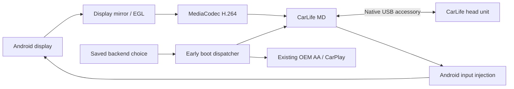

# Baidu CarLife on Android Box

**Carlife_on_box** adds a native Baidu CarLife mobile-device backend to an Android box: the box projects its own Android launcher and applications to a CarLife head unit over USB, and receives touch and navigation input through CarLife.

**English** · [Русский](README.ru.md)

This is a source project for firmware developers and device owners. The working reference is a Carlinkit TBox / SM6350 with Android 15 and a Honda CarLife head unit. It is **not a universal APK or a flashable image for every Android box**: early boot integration, USB routing, privileged display/input access and OEM signing differ between devices.

## What works in the reference setup

- Direct CarLife USB video and input; Android Auto, a Mac and an ADB tunnel are not in the projection path.
- The real Android launcher, applications, on-screen keyboard, Home and Back.
- Display mirroring into EGL / MediaCodec H.264, SPS/PPS + IDR handling, static-frame repetition and encoder presentation timestamps.
- Shared video/touch geometry, asynchronous input, bounded queues, RESET generation fencing, source ownership and the OEM codec-data guard.
- Early backend selection before the OEM projection process owns USB, with a saved Android Auto / CarPlay / Baidu CarLife choice.
- Automatic native startup and reconnect in the tested runtime, including a cold-start test with the head unit ready before power-on.
- The reference radio startup fix and restoration of the OEM floating navigation controls.

A fresh system integration seeds **Baidu CarLife** as the default. A later owner choice is preserved across boots.

## Current limits

| Area | Status |
| --- | --- |
| Reference native runtime | Tested on the development box with a Honda head unit |
| Full integrated OTA candidate | Built and checked offline; **not installed or boot-tested** |
| Other Android boxes | Require a device profile and hardware validation |
| Audio | Opt-in native PCM candidate; offline tests pass, hardware playback unverified |
| Separate TTS/voice, microphone and navigation metadata | Design documented; native producers not implemented |
| Phone verification | Native v2 checksum candidate passes offline tests; legacy RSA and media encryption remain unsupported |
| Honda multitouch | Packet support exists; independent second-finger coordinates were not obtained in the tested mode |
| Hardware RESET mode switching | Button event and CarPlay dialog verified; actual switch and a three-mode cycle not verified/implemented |
| Enforcing SELinux deployment | Not validated; the development firmware was already permissive |
| Latency | Asynchronous input helped; subsequent experiments did not establish a further visible improvement |

The full OTA and proprietary OEM applications are not distributed here. This repository contains source, build tools and tests. Building a JAR successfully does not establish compatibility with a new device or head unit.

[HeadSwap lessons and remaining fixes](docs/HEADSWAP_LESSONS.md) explains the verified gaps, candidate changes and hardware checks still needed.

## Start here

1. [Build the Android MD](docs/BUILD_MD.md) — shared source + native USB overlay, JVM tests and a DEX JAR.
2. [Build the runtime and system overlay](docs/BUILD_RUNTIME.md) — observer, selector service and exact SM6350 integration.
3. [Port to another Android box](docs/PORTING.md) — locate its early projection owner and adapt USB, video, input, permissions and selection.
4. [Run the Mac/Linux HU lab](docs/HU_LAB.md) — native USB test head unit, development TCP transport and packet replay.
5. [Audio candidate and HeadSwap review](docs/AUDIO_CANDIDATE.md) — source changes, startup findings and hardware plan.
6. [Read the validation record](docs/STATUS.md) — what was tested and what remains unverified.

For a dependency-light offline check (Python 3.11+, a C compiler):

```sh
python3 scripts/test_host.py --stdlib-only
python3 -m unittest discover -s tests -p 'test_boot_native_*.py'
python3 -m unittest discover -s tools/boot_native/selector/tests -p 'test_*.py'
python3 -m unittest integration.sm6350.test_system_integration
```

Some host media/GUI tests require the packages in `requirements-hu.txt`. The build commands and exact SDK inputs are described in the linked guides; SDKs and JDKs are not bundled.

## Architecture



The host initiates the Android Open Accessory transition. The box controller owns its gadget configuration, waits for actual kernel events, and starts the native MD. The selector and early dispatcher arrange that there is one USB owner. A late `service.sh` takeover after starting AA is not the intended boot design.

## Repository layout

| Path | Purpose |
| --- | --- |
| `android-md/src`, `android-md/tests` | Common protocol, display, codec, geometry and input |
| `tools/boot_native/md` | Native USB MD overlay and tests |
| `tools/boot_native/runtime` | Reference SM6350 controller and versioned runtime resolver |
| `tools/boot_native/observer` | Authenticated kernel USB event observer |
| `tools/boot_native/selector` | Saved selection, privileged service and OEM UI integration source |
| `tools/boot_native/boot` | Early init / dispatcher templates |
| `integration/sm6350` | Exact reference-firmware system overlay builder and provisioning tests |
| `hu_lab` | Independent host head unit, native USB, protocol, decode and GUI |
| `scripts`, `tests` | Portable source builds and offline regressions |

## Contributing

See [CONTRIBUTING.md](CONTRIBUTING.md). Device reports should include the box/board, Android version, firmware identity, head-unit model, power arrangement and the stage that failed. Remove IMEI, IMSI, ICCID, serial numbers, ADB pairing data and network credentials from logs before sharing.

Keep hardware results separate from mock/offline tests. A port should preserve the working codec/reset/input behavior and explain its boot hook, USB ownership and rollback. Never assume a different box has the reference board's GPIO or configfs layout.

## Credits

Protocol and interoperability research used the public Baidu CarLife projects, AOSP documentation, and the working [HeadSwap](https://github.com/YegorkaPomidorka/headswap) project. See [THIRD_PARTY_NOTICES.md](THIRD_PARTY_NOTICES.md) for scope and upstream licenses.

This project is independent and is not an official product of Baidu, Carlinkit, Honda, Alpine, Google or Apple.

## License

Project-owned source and documentation: [Apache-2.0](LICENSE). Third-party dependencies and OEM inputs retain their own terms; see [THIRD_PARTY_NOTICES.md](THIRD_PARTY_NOTICES.md).
